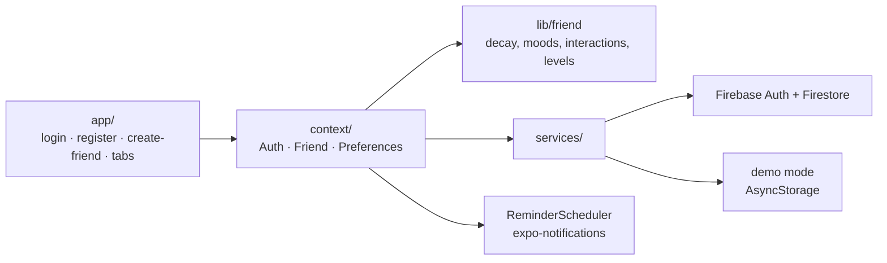

# Kawaii Friend

**English** · [Türkçe](README.tr.md)

A small virtual friend to look after. Sign in, pick a friend and give it a name, then keep it fed, rested and entertained. Its needs change while you are away, and it reminds you when it gets hungry or tired.

[](https://github.com/Beratoguzhan620/kawaii-friend/actions/workflows/ci.yml)


<p align="center"></p>

## Try it

```bash
pnpm install
pnpm web        # in the browser
pnpm start      # then scan the QR code with Expo Go
```

Without Firebase settings the app runs in **demo mode**: accounts and friends are kept on the device, and a banner on the login screen says so. To use Firebase, follow the steps below.

## Firebase setup

1. **Create a project** at [console.firebase.google.com](https://console.firebase.google.com).
2. **Turn on sign-in:** *Build → Authentication → Get started → Sign-in method → Email/Password → Enable*.
3. **Create the database:** *Build → Firestore Database → Create database*, in production mode.
4. **Add a web app:** *Project settings → Your apps → Web (`</>`)*, then copy the `firebaseConfig` values.
5. **Fill in `.env`:**
   ```bash
   cp .env.example .env
   ```
   Put the values into the `EXPO_PUBLIC_FIREBASE_*` lines. `.env` is git-ignored.
6. **Deploy the security rules** (each user can only read and write their own data):
   ```bash
   npx firebase-tools login
   npx firebase-tools deploy --only firestore:rules --project <your-project-id>
   ```
7. Restart the app with `pnpm start --clear` so Expo picks up the new variables. The banner disappears, and *Settings → Account* shows "Firebase".

To work fully offline, set `EXPO_PUBLIC_FIREBASE_EMULATOR_HOST=localhost` instead and run `npx firebase-tools emulators:start --only auth,firestore --project demo-kawaii-friend`. CI uses the same set-up.

## Features

- **Accounts:**
  - Register, sign in and sign out with email and password through Firebase Auth.
  - Errors are explained in Turkish next to the field.
  - Nothing past the login screen opens without an account, and the session survives restarts.
- **Your own friend:** choose Mochi, Tofu or Bulut (three original characters drawn for the app), and give it a name.
- **Needs that change over time:**
  - Hunger rises while energy and happiness fall, worked out from the time of the last interaction.
  - The friend's face changes with its mood: happy, hungry, tired or bored.
- **Feed, play and rest:**
  - Each one changes the stats, saves to Firestore and updates the screen straight away, with a small bounce and a line of feedback.
  - A worn-out friend cannot play until it rests.
  - Every interaction gives 10 XP, and every 100 XP is a new level.
- **History tab:** recent interactions, newest first, with the mood and level after each one.
- **Reminders:**
  - Local notifications are scheduled for when the friend will get hungry and tired, and rescheduled after every interaction.
  - They can be turned off in Settings. A test button appears in development builds.
- **Settings:**
  - Reminders on or off, and a system, light or dark theme. Both are remembered on the device.
  - Resetting the friend asks first.
  - The account section shows the email and where the data is kept.
- **Design:** pastel colours and soft corners, an exception to the shared design system that this assignment asked for. Emoji appear only in notifications.

## Screenshots

| Sign in | New friend | Friend | Hungry |
|---|---|---|---|
|  |  |  |  |

| History | Settings | Dark |
|---|---|---|
|  |  |  |

The screenshots come from the web build in demo mode. Notifications only exist in the phone apps.

## Data model

```text
users/{uid}
  email, friendName, character (mochi | tofu | bulut),
  friendState (happy | hungry | tired | bored), lastInteraction,
  level, xp, hunger, energy, happiness (0–100), createdAt

users/{uid}/interactions/{id}
  type (feed | play | rest), at, friendState, level
```

- Only the values at the last interaction are stored. The app works out the current ones from the time since then, so nothing has to run in the background.
- [`firestore.rules`](firestore.rules) lets each user see and change only their own documents, and checks the shape and range of every field. The history is append-only.

## Tech stack

- Expo SDK 58 (managed), React Native 0.88, expo-router (tabs and guarded routes), TypeScript in strict mode
- Firebase JS SDK: Auth, with the session kept in AsyncStorage on phones, and Firestore
- expo-notifications for the local reminders, react-native-svg for the characters and bars, Reanimated for the bounce
- NativeWind (Tailwind): every style is a `className`; CI fails on inline styles
- Vitest for the logic, `@firebase/rules-unit-testing` for the security rules, Playwright for the end-to-end flow
- GitHub Actions:
  - Type check, lint and unit tests.
  - The end-to-end flow in demo mode.
  - The security rules and the same end-to-end flow against the Firebase Auth and Firestore emulators.

## How it is built



- `lib/friend.ts` holds the rules as pure functions: `statsAt`, `moodOf`, `interact`, `nextAlerts`. The screens and the reminders both use them, and the tests check them without a device.
- `services/` has one interface for sign-in and one for the friend store, each with a Firebase and a demo implementation. `config.ts` picks one from `.env`.
- The root layout guards the routes: signed out → login; signed in without a friend → create-friend; otherwise → the tabs.

## Scripts

| Command | What it does |
|---|---|
| `pnpm start` / `pnpm web` | Expo dev server (native / web) |
| `pnpm typecheck` | `tsc --noEmit` |
| `pnpm lint` | ESLint (expo config) |
| `pnpm test` | Unit tests |
| `pnpm test:rules` | Security rules tests on the Firestore emulator (needs Java) |
| `pnpm build:web` | Static web build in `dist/` |
| `pnpm serve:web` | Serve `dist/` on port 8090 |
| `pnpm test:e2e` | End-to-end flow against the served build |
| `pnpm icons` | Render the app icon, splash and notification icon |
| `pnpm media:readme` | Record the README screenshots and walkthrough |

## Tests

- **Unit tests:**
  - Decay over time, mood priority, the three interactions, levelling, when reminders fire, and Turkish suffixes (*Mochi'nin*, *Bulut'un*).
  - Form checks and error messages, picking the backend from `.env`, the demo stores and the device preferences.
- **Security rules:**
  - Owners can read and write their own documents; other users and signed-out visitors cannot.
  - Invalid fields are rejected, and the email, the creation date and the history cannot be changed.
- **End to end**, on phone and desktop sizes:
  - Registering, form errors, creating a friend and the three interactions.
  - Data surviving a reload, the history order, reaching level 2, and time passing until the friend is hungry and too tired to play.
  - Settings being remembered, resetting the friend, and sign-out guarding the app.
  - The same flow runs in demo mode and against the Firebase emulators.

## Roadmap and known gaps

- A screenshot of a notification on a real phone, and a check of the whole app on a device.
- Live web demo.
- Push notifications from a server, so reminders also reach a phone where the app was never opened after signing in.

## Background

This project started as a bootcamp project and was later rebuilt from the ground up. The assignment asked for an Expo app in TypeScript with NativeWind, Firebase email sign-in, the friend's state in Firestore, three interactions, a history tab and notifications. What this version adds:

- **Game:** needs that change over time, moods worked out from the stats, levels and XP, and a rule that a tired friend cannot play.
- **Characters:** three original characters drawn in SVG, with a face for each mood.
- **Reminders:** notifications timed for the moment the friend gets hungry or tired, instead of a fixed interval.
- **Safety:** Firestore security rules with tests, and secrets kept in `.env`.
- **Try without set-up:** a demo mode that runs without a Firebase project.
- **Quality:** unit tests, rules tests, an end-to-end flow run both in demo mode and on the Firebase emulators, and CI on every pull request.

## License

[MIT](LICENSE) · Berat Oğuzhan Turğut · [GitHub](https://github.com/Beratoguzhan620)
