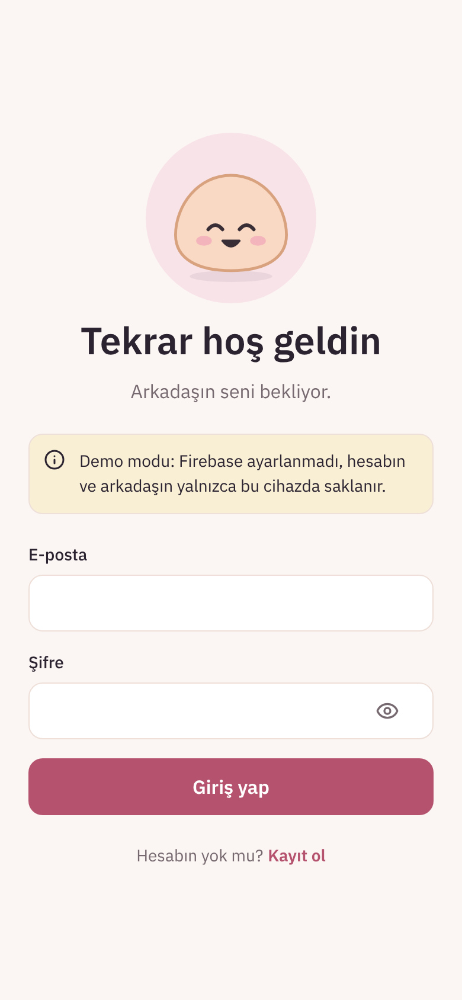
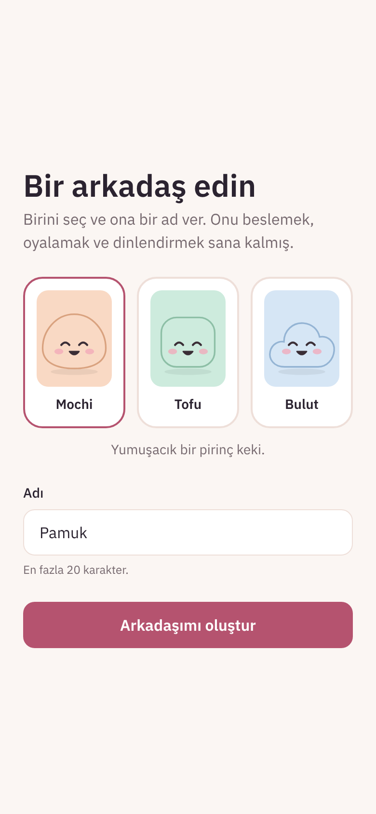
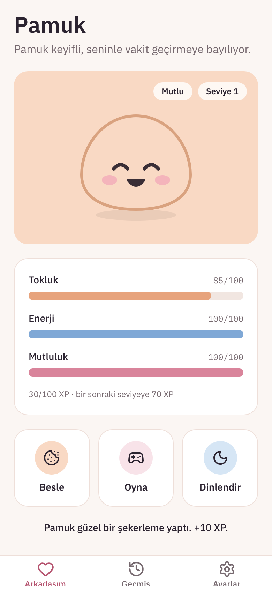
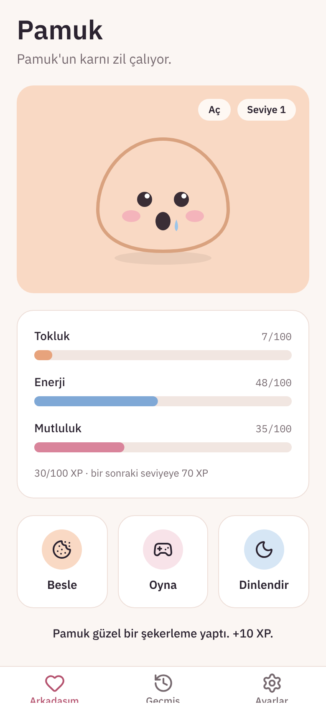
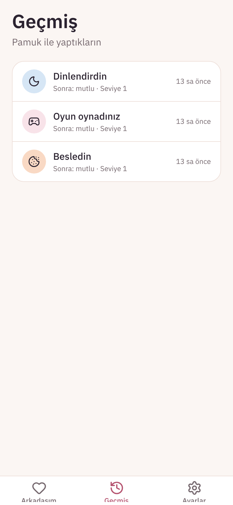
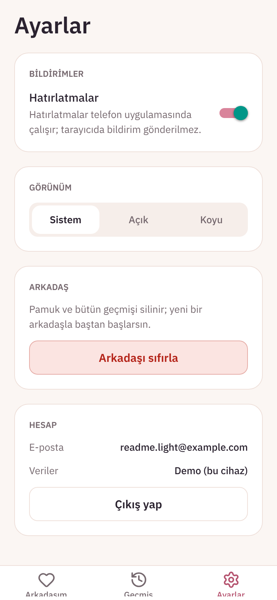
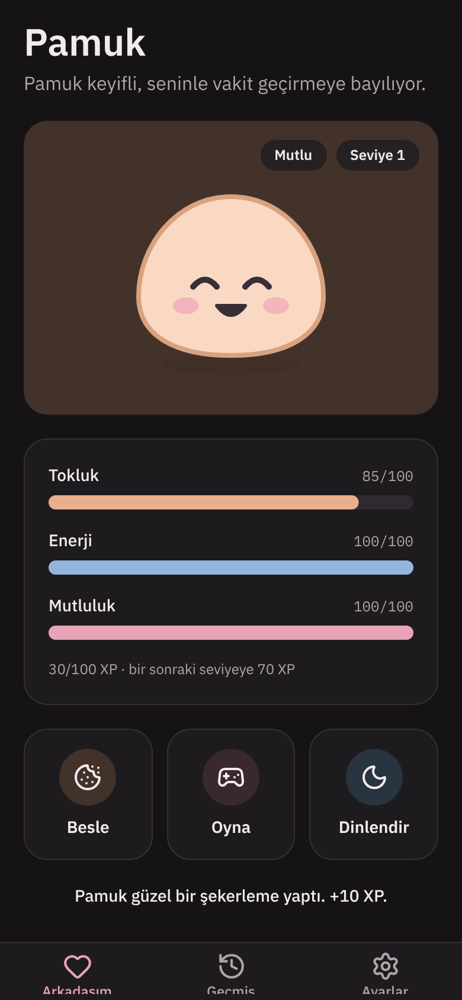
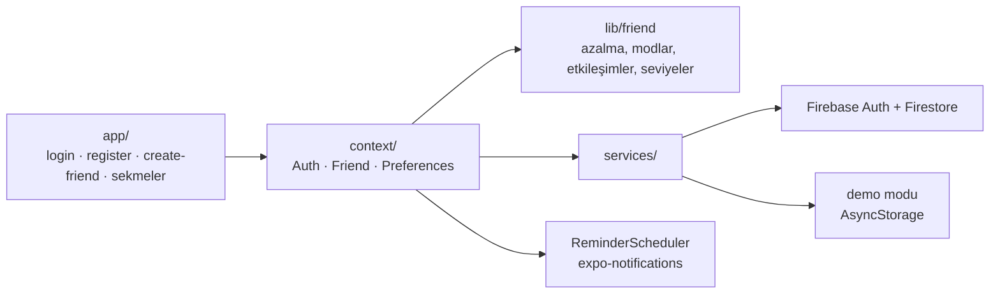

# Kawaii Friend

[English](README.md) · **Türkçe**

Bakımı sana kalmış küçük bir sanal arkadaş. Giriş yap, bir arkadaş seçip ona ad ver; sonra onu tok, dinlenmiş ve keyifli tut. Sen yokken ihtiyaçları değişir; acıkınca ya da yorulunca sana haber verir.

[](https://github.com/Beratoguzhan620/kawaii-friend/actions/workflows/ci.yml)


<p align="center"></p>

## Deneme

```bash
pnpm install
pnpm web        # tarayıcıda
pnpm start      # sonra QR kodu Expo Go ile okut
```

Firebase ayarı yoksa uygulama **demo modunda** çalışır: hesaplar ve arkadaşlar cihazda saklanır, giriş ekranındaki bir bant da bunu söyler. Firebase kullanmak için aşağıdaki adımları izle.

## Firebase kurulumu

1. **Proje oluştur:** [console.firebase.google.com](https://console.firebase.google.com) adresinde yeni bir proje aç.
2. **Girişi aç:** *Build → Authentication → Get started → Sign-in method → Email/Password → Enable*.
3. **Veritabanını oluştur:** *Build → Firestore Database → Create database*, production modunda.
4. **Web uygulaması ekle:** *Project settings → Your apps → Web (`</>`)*, ardından `firebaseConfig` değerlerini kopyala.
5. **`.env` dosyasını doldur:**
   ```bash
   cp .env.example .env
   ```
   Değerleri `EXPO_PUBLIC_FIREBASE_*` satırlarına yaz. `.env` git'e girmez.
6. **Güvenlik kurallarını yükle** (her kullanıcı yalnızca kendi verisini okuyup yazabilir):
   ```bash
   npx firebase-tools login
   npx firebase-tools deploy --only firestore:rules --project <proje-id>
   ```
7. Expo'nun yeni değişkenleri görmesi için uygulamayı `pnpm start --clear` ile yeniden başlat. Bant kaybolur ve *Ayarlar → Hesap* bölümünde "Firebase" yazar.

Tamamen çevrimdışı çalışmak için bunun yerine `EXPO_PUBLIC_FIREBASE_EMULATOR_HOST=localhost` ayarla ve `npx firebase-tools emulators:start --only auth,firestore --project demo-kawaii-friend` komutunu çalıştır. CI da aynı kurulumu kullanıyor.

## Özellikler

- **Hesaplar:**
  - Firebase Auth ile e-posta ve şifreyle kayıt, giriş ve çıkış.
  - Hatalar alanın yanında Türkçe açıklanır.
  - Hesap olmadan giriş ekranının ötesine geçilemez; oturum uygulama kapanıp açılınca da sürer.
- **Kendi arkadaşın:** Mochi, Tofu ya da Bulut'u seç (uygulama için çizilmiş üç özgün karakter) ve ona bir ad ver.
- **Zamanla değişen ihtiyaçlar:**
  - Açlık artar, enerji ve mutluluk azalır; hepsi son etkileşimin zamanından hesaplanır.
  - Arkadaşın yüzü moduna göre değişir: mutlu, aç, yorgun ya da sıkılmış.
- **Besle, oyna, dinlendir:**
  - Her biri göstergeleri değiştirir, Firestore'a kaydedilir ve ekranı anında günceller; küçük bir zıplama ve bir satır geri bildirim eşlik eder.
  - Çok yorulan arkadaş dinlenmeden oynayamaz.
  - Her etkileşim 10 XP kazandırır; her 100 XP yeni bir seviye demek.
- **Geçmiş sekmesi:** son etkileşimler, en yenisi en üstte; her birinden sonraki mod ve seviyeyle birlikte.
- **Hatırlatmalar:**
  - Arkadaşın acıkacağı ve yorulacağı ana yerel bildirim planlanır; her etkileşimden sonra yeniden planlanır.
  - Ayarlar'dan kapatılabilir. Geliştirme derlemelerinde bir test düğmesi çıkar.
- **Ayarlar:**
  - Hatırlatmaları açıp kapama ve sistem, açık ya da koyu tema; ikisi de cihazda hatırlanır.
  - Arkadaşı sıfırlamadan önce onay istenir.
  - Hesap bölümü e-postayı ve verinin nerede tutulduğunu gösterir.
- **Tasarım:** pastel renkler ve yumuşak köşeler; ödevin istediği, ortak tasarım sisteminden bir istisna. Emoji yalnızca bildirimlerde kullanılıyor.

## Ekran görüntüleri

| Giriş | Yeni arkadaş | Arkadaş | Aç |
|---|---|---|---|
|  |  |  |  |

| Geçmiş | Ayarlar | Koyu |
|---|---|---|
|  |  |  |

Ekran görüntüleri web sürümünden, demo modunda alındı. Bildirimler yalnızca telefon uygulamasında var.

## Veri modeli

```text
users/{uid}
  email, friendName, character (mochi | tofu | bulut),
  friendState (happy | hungry | tired | bored), lastInteraction,
  level, xp, hunger, energy, happiness (0–100), createdAt

users/{uid}/interactions/{id}
  type (feed | play | rest), at, friendState, level
```

- Yalnızca son etkileşimdeki değerler saklanır. Uygulama güncel değerleri o andan bu yana geçen süreden hesaplar; arka planda bir şeyin çalışması gerekmez.
- [`firestore.rules`](firestore.rules) her kullanıcının yalnızca kendi belgelerini görüp değiştirmesine izin verir ve her alanın tipini ve aralığını kontrol eder. Geçmiş yalnızca eklenebilir.

## Teknolojiler

- Expo SDK 58 (managed), React Native 0.88, expo-router (sekmeler ve korumalı rotalar), strict modda TypeScript
- Firebase JS SDK: Auth (telefonda oturum AsyncStorage'da tutulur) ve Firestore
- Yerel hatırlatmalar için expo-notifications, karakterler ve göstergeler için react-native-svg, zıplama için Reanimated
- NativeWind (Tailwind): bütün stiller `className`; satır içi stil olursa CI hata verir
- Mantık için Vitest, güvenlik kuralları için `@firebase/rules-unit-testing`, uçtan uca akış için Playwright
- GitHub Actions:
  - Tip kontrolü, lint ve birim testleri.
  - Demo modunda uçtan uca akış.
  - Firebase Auth ve Firestore emülatörlerinde güvenlik kuralları ve aynı uçtan uca akış.

## Nasıl çalışıyor



- `lib/friend.ts` kuralları saf fonksiyonlar olarak tutar: `statsAt`, `moodOf`, `interact`, `nextAlerts`. Hem ekranlar hem hatırlatmalar bunları kullanır; testler de cihaz olmadan kontrol eder.
- `services/` içinde giriş için bir arayüz, arkadaş verisi için bir arayüz var; her birinin Firebase ve demo uygulaması bulunuyor. `config.ts` hangisinin kullanılacağını `.env`'den seçer.
- Kök layout rotaları korur: çıkış yapılmışsa → giriş; giriş yapılmış ama arkadaş yoksa → arkadaş oluşturma; aksi halde → sekmeler.

## Komutlar

| Komut | Ne yapar |
|---|---|
| `pnpm start` / `pnpm web` | Expo geliştirme sunucusu (telefon / web) |
| `pnpm typecheck` | `tsc --noEmit` |
| `pnpm lint` | ESLint (expo yapılandırması) |
| `pnpm test` | Birim testleri |
| `pnpm test:rules` | Firestore emülatöründe güvenlik kuralı testleri (Java gerekir) |
| `pnpm build:web` | `dist/` klasörüne statik web derlemesi |
| `pnpm serve:web` | `dist/` klasörünü 8090 portunda sunar |
| `pnpm test:e2e` | Sunulan derlemeye karşı uçtan uca akış |
| `pnpm icons` | Uygulama ikonunu, açılış ekranını ve bildirim ikonunu üretir |
| `pnpm media:readme` | README ekran görüntülerini ve tanıtım kaydını alır |

## Testler

- **Birim testleri:**
  - Zamanla azalma, mod önceliği, üç etkileşim, seviye atlama, hatırlatmaların zamanı ve Türkçe ekler (*Mochi'nin*, *Bulut'un*).
  - Form kontrolleri ve hata mesajları, `.env`'den arka uç seçimi, demo depoları ve cihaz tercihleri.
- **Güvenlik kuralları:**
  - Sahibi kendi belgelerini okuyup yazabilir; başka kullanıcılar ve giriş yapmamış ziyaretçiler yapamaz.
  - Hatalı alanlar reddedilir; e-posta, oluşturulma tarihi ve geçmiş değiştirilemez.
- **Uçtan uca**, telefon ve masaüstü boyutlarında:
  - Kayıt, form hataları, arkadaş oluşturma ve üç etkileşim.
  - Sayfa yenilenince verinin kalması, geçmiş sırası, 2. seviyeye çıkış ve arkadaş acıkıp oynayamayacak kadar yorulana kadar zamanın ilerlemesi.
  - Ayarların hatırlanması, arkadaşı sıfırlama ve çıkışın uygulamayı koruması.
  - Aynı akış hem demo modunda hem Firebase emülatörlerinde çalışır.

## Yol haritası ve eksikler

- Gerçek telefonda bir bildirim ekran görüntüsü ve uygulamanın cihazda baştan sona denenmesi.
- Canlı web demosu.
- Sunucudan push bildirim; böylece hatırlatmalar, girişten sonra uygulamanın hiç açılmadığı bir telefona da ulaşır.

## Arka plan

Bu proje bir bootcamp projesi olarak başladı, sonra baştan geliştirildi. Ödev; TypeScript ve NativeWind ile yazılmış, Firebase e-posta girişi olan, arkadaşın durumunu Firestore'da tutan, üç etkileşimi, bir geçmiş sekmesi ve bildirimleri olan bir Expo uygulaması istiyordu. Bu sürümde eklenenler:

- **Oyun:** zamanla değişen ihtiyaçlar, göstergelerden hesaplanan modlar, seviye ve XP, yorgun arkadaşın oynayamaması.
- **Karakterler:** SVG ile çizilmiş üç özgün karakter; her mod için ayrı bir yüz.
- **Hatırlatmalar:** sabit aralık yerine arkadaşın acıkacağı ya da yorulacağı ana göre planlanan bildirimler.
- **Güvenlik:** testleriyle birlikte Firestore güvenlik kuralları; gizli bilgiler `.env`'de.
- **Kurulumsuz deneme:** Firebase projesi olmadan çalışan demo modu.
- **Kalite:** birim testleri, kural testleri, hem demo modunda hem Firebase emülatörlerinde çalışan uçtan uca akış ve her pull request'te CI.

## Lisans

[MIT](LICENSE) · Berat Oğuzhan Turğut · [GitHub](https://github.com/Beratoguzhan620)
